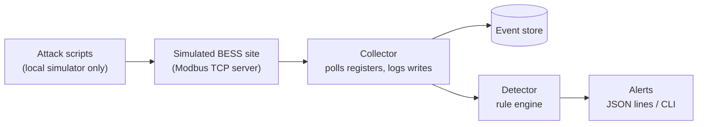

# GridGuard

**Open-source monitoring for the control traffic of small solar-plus-storage sites.**

GridGuard checks Modbus TCP control traffic against configurable physical limits and flags commands and telemetry that look unsafe, spoofed or out of schedule. It is written in Go and designed for small sites that have no security team.

> **Project status: early prototype, in active development.**
> GridGuard runs only against a simulated battery site. It has not been tested on real hardware and has no published evaluation results yet. See [Status](#status) for exactly what works today.

---

## Why this exists

Solar and batteries are increasingly dispatched remotely. The industrial protocols that carry those commands, most commonly Modbus TCP, have no built-in authentication or encryption. Small commercial, community and minigrid storage sites often have no security monitoring at all.

If the command and telemetry layer cannot be verified, flexible assets become operational risks. A bad setpoint or spoofed reading can cause rapid cycling that wears cells out, unexpected disconnection, or loss of visibility for the operator.

GridGuard is a small, open tool that gives such sites a baseline of monitoring.

## What it does

GridGuard watches the control and telemetry registers of a battery site and applies rules based on physical limits and expected behaviour:

- Flags control writes from sources that are not on an allowlist
- Flags power setpoints outside configured safe limits
- Flags rapid charge/discharge reversals that accelerate cell wear
- Flags telemetry that is inconsistent, such as reported power that does not match the change in state-of-charge
- Flags frozen or replayed readings
- Flags commands outside the scheduled dispatch window
- Flags changes to the grid export limit

Every rule is mapped to [MITRE ATT&CK for ICS](https://attack.mitre.org/matrices/ics/).

## How it differs from existing tools

General Modbus intrusion detection already exists, for example Snort and Suricata rules, Zeek's Modbus analysis and commercial OT security products. GridGuard does not try to replace them. Its focus is narrower:

- **Battery-specific consistency checks**, such as power versus state-of-charge, and cycling patterns that wear cells
- **A lightweight, single-binary tool** suited to small installations
- **Open rules, simulator and attack scenarios** that others can reuse and challenge

## Architecture



| Component | Role |
|---|---|
| Simulator | Fake solar-plus-battery site exposing Modbus registers (state of charge, power setpoint, export limit and others) and a simple dispatch loop |
| Collector | Polls registers, records control writes and their source, and normalises events |
| Detector | Runs the rules and emits alerts with the evidence values |
| Attack scripts | Small scripts that trigger each rule against the local simulator only |

## Detection rules

| ID | Rule | What it catches | MITRE ATT&CK for ICS |
|---|---|---|---|
| R1 | Unauthorised writer | Control write from a source not on the allowlist | T0855 Unauthorized Command Message |
| R2 | Out-of-bounds setpoint | Setpoint beyond configured safe limits | T0836 Modify Parameter |
| R3 | Rapid reversal | Charge/discharge flips faster than a threshold, repeated in a window | T0831 Manipulation of Control |
| R4 | Telemetry inconsistency | State-of-charge change does not match reported power | T0856 Spoof Reporting Message |
| R5 | Frozen or replayed telemetry | Readings that stay identical while time advances | T0856 Spoof Reporting Message, T0832 Manipulation of View |
| R6 | Off-schedule command | Command from a valid source outside the dispatch window | T0855 Unauthorized Command Message |
| R7 | Export-limit tampering | Any change to the grid export limit register | T0836 Modify Parameter |

Thresholds are configurable and are placeholders until validated with real operators.

## Status

Legend: ✅ working, 🚧 in progress, ⬜ planned.

| Item | Status |
|---|---|
| Modbus TCP site simulator (state of charge, setpoint, export limit, reported power) | ✅ |
| Inline monitor that parses Modbus frames and raises alerts | ✅ |
| R1 Unauthorised source | ✅ |
| R2 Out-of-bounds setpoint | ✅ |
| R3 Rapid charge/discharge reversal | ✅ |
| R7 Export-limit tampering | ✅ |
| Basic checks: unexpected function code, writes to read-only telemetry registers | ✅ |
| Scripted scenarios (normal operation and four attacks) | ✅ |
| R4 Telemetry inconsistency (power vs state-of-charge) | ⬜ |
| R5 Frozen or replayed telemetry | ⬜ |
| R6 Off-schedule command | ⬜ |
| Event store, JSON alert output, configuration file | ⬜ |
| Measured evaluation (true and false positives, latency) | ⬜ |
| Pilot with a real site | ⬜ |

## Quick start

Requirements: Go 1.22 or later, Linux. The unauthorised-source scenario uses the 127.0.0.2 loopback address, which macOS does not provide by default.

```bash
git clone https://github.com/d3v-sh/GridGuard.git
cd GridGuard
go run . demo
```

`go run . demo` starts the simulator and the monitor in one process, then runs a normal scenario followed by four attack scenarios. To run the parts separately, use three terminals:

```bash
go run . sim                 # terminal 1: simulated site
go run . guard               # terminal 2: monitor
go run . client bounds       # terminal 3: one of normal, bounds, reversal, source, export
```

The attack scenarios target only the local simulator. Don't point them at real equipment.

Requirements: Go 1.22 or later.


## Threat model

**Assets:** the integrity of control commands and telemetry at a small solar-plus-storage site.

**Attacker capabilities considered:** a network-adjacent attacker or compromised device that can send Modbus writes, replay or spoof readings, or alter limits, and a faulty or malicious automated dispatcher.

**Out of scope for now:** firmware-level compromise, hardware-in-the-loop validation, protocols other than Modbus TCP (for example IEC 61850), and encrypted or authenticated variants of Modbus.

## Evaluation

No evaluation results yet. When available, results will be generated by the evaluation script and published in `docs/results.md`: per-rule true positives, false negatives, false positives and detection latency on synthetic scenarios. Every number in this README will come from that run.

## Limitations

- Evaluated, when finished, only on synthetic data and a simulated site
- Simplified battery physics and a single site
- Modbus TCP only
- No validation on real hardware or against real operator data
- Rule thresholds are untuned defaults

## Roadmap

1. First end-to-end slice: simulator, collector, one rule and one attack script
2. Remaining rules with unit tests
3. Scenario-based evaluation and published results
4. Validate thresholds with operators and engineers
5. Pilot at a small solar or minigrid site
6. Open training material on inspecting and defending industrial control protocols for energy systems

## Responsible use

The attack scripts exist only to test GridGuard against its own simulator. Run them only on systems you own or are authorised to test. Do not point them at real equipment.

## Contributing and licence

Issues and pull requests are welcome. GridGuard is licensed under the [Apache License 2.0](LICENSE).

## Author

Dev Shishodia [github.com/d3v-sh](https://github.com/d3v-sh)